# Screenshots

Captured from the running app on the sample case (made-up people, reserved example domains)
at 1440×900 and 390×844, before and after the October 2026 overhaul.

| Screen | Before | After |
|---|---|---|
| Case (findings) | 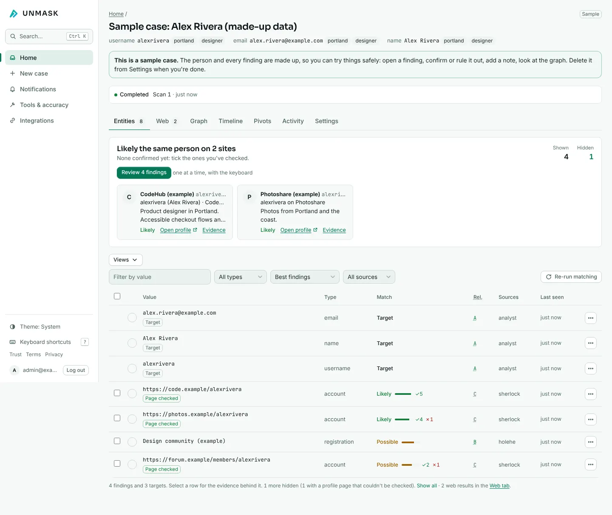 | 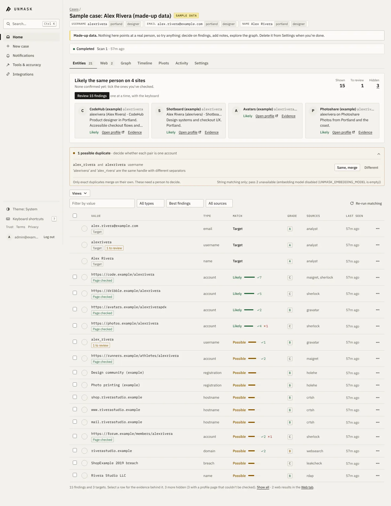 |
| Graph | 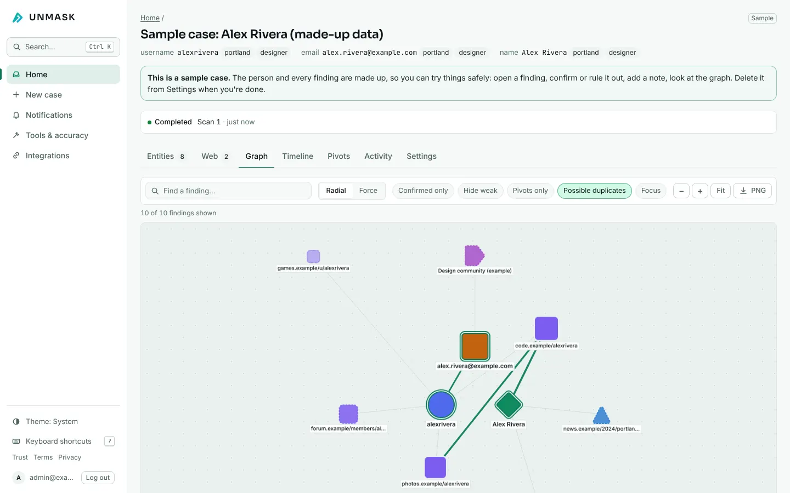 | 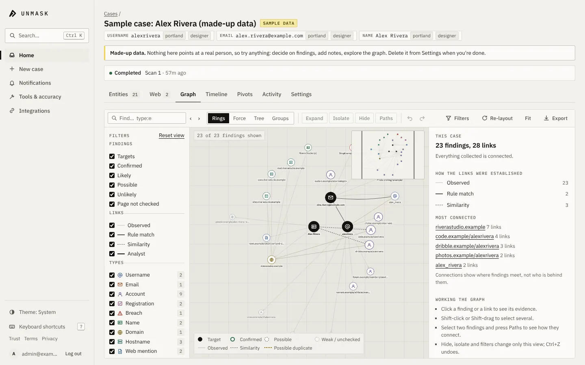 |
| Home | 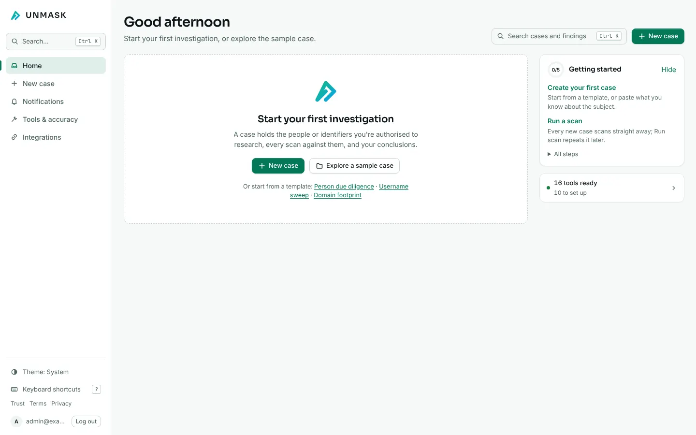 | 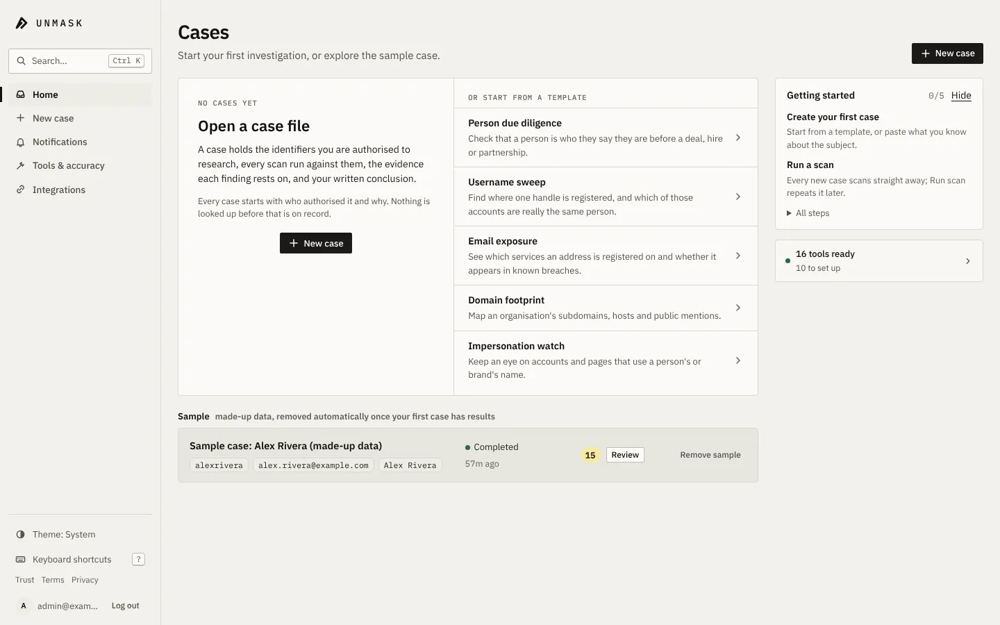 |
| Review queue | 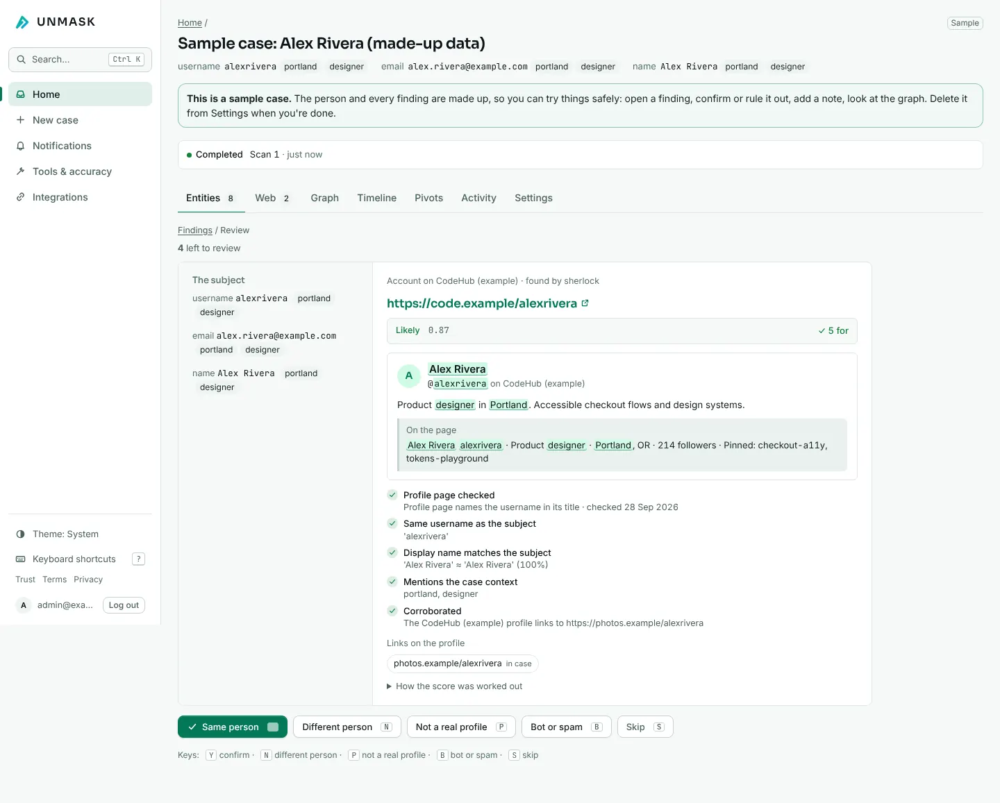 | 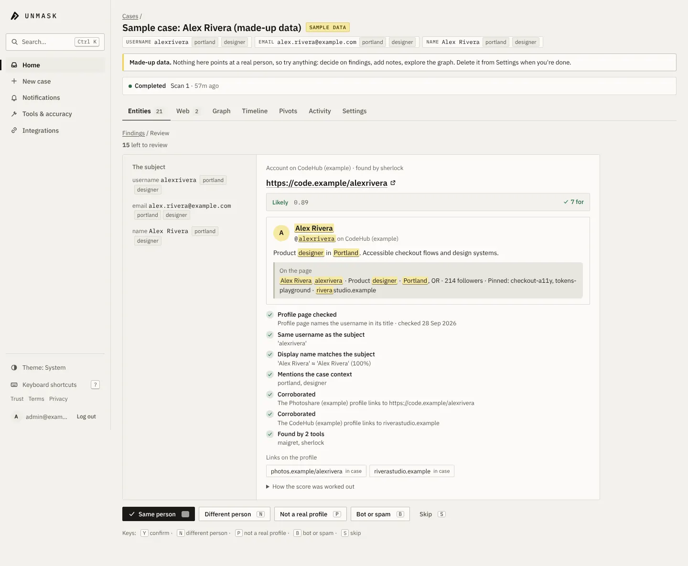 |
| Graph on a phone | 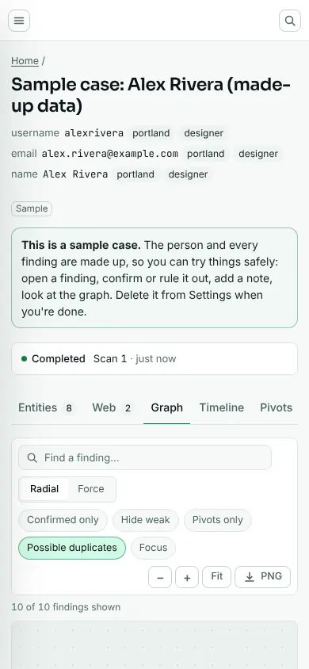 | 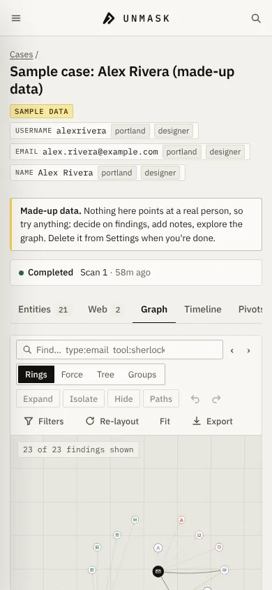 |
| Landing | 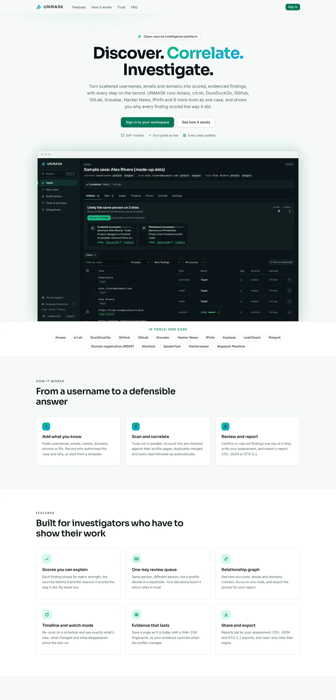 | 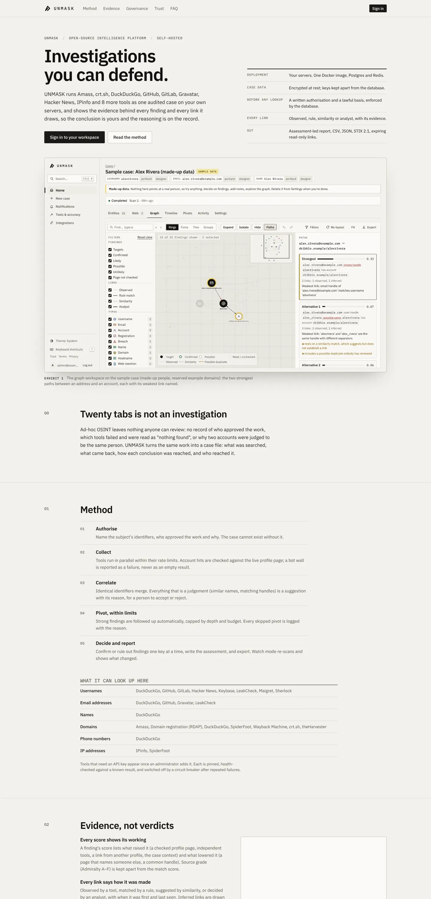 |

After only: [paths between two findings](graph-paths.webp), [link inspector](link-inspector.webp),
[graph, dark](graph-dark.webp), [settings, dark](settings-dark.webp), [tools and source behaviour](tools.webp),
[landing on a phone, dark](landing-mobile-dark.webp).
